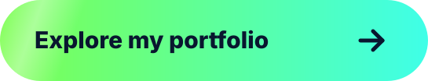
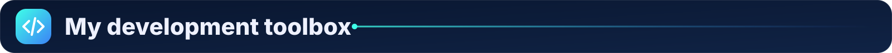
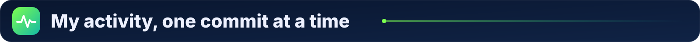
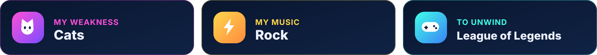

  🌐 <a href="./README.md" lang="es">Español</a> &nbsp;·&nbsp; <strong>English</strong>

  <picture>
    <source media="(prefers-reduced-motion: reduce)" srcset="./assets/profile-header.png">
    
  </picture>

<h1 align="center">
<picture>
  <source media="(max-width: 600px) and (prefers-reduced-motion: reduce)" srcset="./assets/v2/en/intro-mobile-still.svg">
  <source media="(max-width: 600px)" srcset="./assets/v2/en/intro-mobile.svg">
  <source media="(prefers-reduced-motion: reduce)" srcset="./assets/v2/en/intro-still.svg">
  
</picture>
</h1>

  🎓 In the final stretch of Software Engineering · Universidad Técnica de Ambato · 🌎 Ecuador

  
  &nbsp;
  

  <a href="#projects">🚀 Projects</a> &nbsp;·&nbsp;
  <a href="#stack">🛠️ Stack</a> &nbsp;·&nbsp;
  <a href="#activity">🐍 Activity</a> &nbsp;·&nbsp;
  <a href="#about">🐾 About&nbsp;me</a> &nbsp;·&nbsp;
  <a href="#contact">🤝 Contact</a>

<h2>
<picture>
  <source media="(max-width: 600px)" srcset="./assets/v2/en/h-projects-mobile.svg">
  
</picture>
</h2>

Web interfaces, event management and AI automation: a selection of my **academic and personal projects**. 👇

  
  

  
  

**🤖 LUPSI ChatOps** connects Telegram to Trello and GitHub to query project progress, retrieve document context and generate PDF reports. It includes human approval flows for selected actions.

  📸 Full-size views: <a href="./assets/screens/eventconnect.png">EventConnect</a> · <a href="./assets/screens/hospitalapp.png">HospitalApp</a> · <a href="./assets/screens/sales.png">Sales</a> · <a href="./assets/screens/telegram-hitl.png">LUPSI (repository visual)</a>

<strong>🧩 More projects using this stack</strong>

**📱 [EventConnect Mobile](https://github.com/T1Angel4220/eventconnect-movil)** — React Native, Expo and TypeScript for discovering events, managing registrations and receiving notifications.

**⛽ [Combustible SKT](https://github.com/T1Angel4220/Combustible-SKT)** — Microservices with Java, Spring Boot, gRPC, MongoDB, PostgreSQL and Docker.

**🐍 [Messaging and video calls](https://github.com/T1Angel4220/Mensajes_VideoLlamada)** — Python, Flask, JavaScript and WebRTC.

**🖥️ [Approximation calculator](https://github.com/T1Angel4220/CalculadoraAproximacion)** — Python, PySide6, NumPy and Matplotlib.

  <a href="https://github.com/T1Angel4220?tab=repositories">🔎 Explore all my repositories ↗</a>

<h2>
<picture>
  <source media="(max-width: 600px)" srcset="./assets/v2/en/h-stack-mobile.svg">
  
</picture>
</h2>

**Frontend** is my focus. I connect it to APIs, databases and cloud services. I also prepare builds, configure environment variables and publish applications with **Azure, Docker, Nginx and GitHub Pages**.

<picture>
  <source media="(max-width: 600px)" srcset="./assets/v2/en/stack-mobile.svg">
  
</picture>

🧠 **AI and integrations:** OpenRouter · NVIDIA NIM · Telegraf · Trello and GitHub APIs · PDFKit · document context retrieval.

<h2>
<picture>
  <source media="(max-width: 600px)" srcset="./assets/v2/en/h-activity-mobile.svg">
  
</picture>
</h2>

  <a href="https://github.com/T1Angel4220">
    <picture>
      <source media="(prefers-color-scheme: dark)" srcset="https://raw.githubusercontent.com/T1Angel4220/T1Angel4220/output/github-snake-dark.svg">
      <source media="(prefers-color-scheme: light)" srcset="https://raw.githubusercontent.com/T1Angel4220/T1Angel4220/output/github-snake.svg">
      
    </picture>
  </a>

<h2>
<picture>
  <source media="(max-width: 600px)" srcset="./assets/v2/en/h-about-mobile.svg">
  
</picture>
</h2>

I enjoy learning by building, paying attention to interface details and understanding what happens after each click.

<picture>
  <source media="(max-width: 600px)" srcset="./assets/v2/en/interests-mobile.svg">
  
</picture>

💙 Favorite color: midnight blue. You might have noticed.

<h2>
<picture>
  <source media="(max-width: 600px)" srcset="./assets/v2/en/h-contact-mobile.svg">
  
</picture>
</h2>

I'm looking for a **junior frontend or full stack opportunity** where I can contribute to a product, learn from other developers and grow with a team. If my profile fits what you're building, let's talk. ✉️

   
  <a href="mailto:aayuquina4220@uta.edu.ec">aayuquina4220@uta.edu.ec</a>

<picture>
  <source media="(max-width: 600px)" srcset="./assets/v2/en/footer-mobile.svg">
  
</picture>

  <a href="./README.md" lang="es">Leer en español</a> &nbsp;·&nbsp; <a href="#top">↑ Back to top</a>

