  <picture>
    <source media="(max-width: 600px)" srcset="./assets/v3/en/hero-mobile.svg">
    
  </picture>

  
  &nbsp;
  

  <a href="#projects">Projects</a> &nbsp;·&nbsp;
  <a href="#stack">Stack</a> &nbsp;·&nbsp;
  <a href="#activity">Activity</a> &nbsp;·&nbsp;
  <a href="#about">About</a> &nbsp;·&nbsp;
  <a href="#contact">Contact</a>

I build **full stack applications**, connecting web interfaces, APIs and databases through to deployment. My main tools include **TypeScript, JavaScript, React, Node.js, Express and SQL**. I am finishing my Software Engineering degree at Universidad Técnica de Ambato (Ecuador) and I am looking for my first **junior full stack role**.

<h2>
  
</h2>

A selection of my **academic and personal projects**. Each card links to the code.

  
  

  
  

  

<h2>
  
</h2>

My focus is **full stack development**: interfaces, backend services, data and deployment. The toolbox below distinguishes **primary use** from **knowledge**, based on my work and practice. I prepare builds, configure environment variables and publish applications; **Docker** is part of my main workflow, with additional knowledge of **Azure, Render and Vercel**.

<picture>
  <source media="(max-width: 600px)" srcset="./assets/v3/en/stack-mobile.svg">
  
</picture>

<h2>
  
</h2>

  <a href="https://github.com/T1Angel4220">
    <picture>
      <source media="(prefers-color-scheme: dark)" srcset="https://raw.githubusercontent.com/T1Angel4220/T1Angel4220/output/github-snake-dark.svg">
      <source media="(prefers-color-scheme: light)" srcset="https://raw.githubusercontent.com/T1Angel4220/T1Angel4220/output/github-snake.svg">
      
    </picture>
  </a>

<h2>
  
</h2>

<h2>
  
</h2>

I am looking for a **junior full stack** opportunity where I can contribute to a product, learn from other developers and grow with a team. If my profile fits what you are building, let us talk.

   
  <a href="mailto:ayuquinaangel4220@gmail.com">ayuquinaangel4220@gmail.com</a>

  <a href="#top">↑ Back to top</a>

