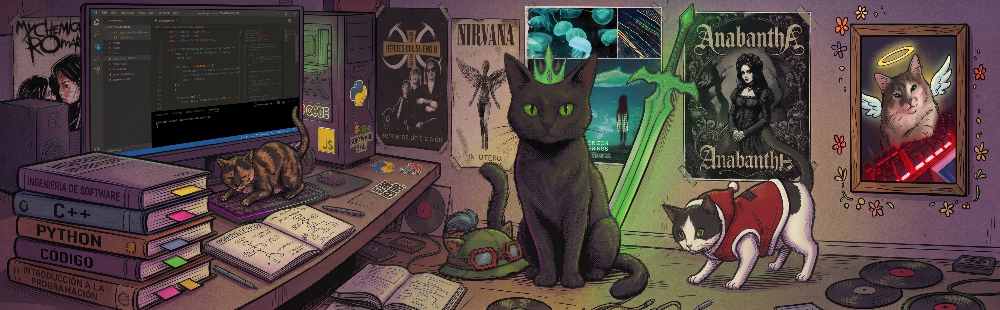

  🌐 <a href="./README.md" lang="es">Español</a> &nbsp;·&nbsp; <strong>English</strong>

<h1 align="center">👋 Hey! I'm Angel Ayuquina</h1>

  <strong>🎨 Frontend Developer</strong> &nbsp; / &nbsp; 🧩 Full Stack

  

  Clear interfaces, reusable components and connected applications. 
  🎓 Software Engineering student · Universidad Técnica de Ambato · 🌎 Ecuador

  
  &nbsp;
  

  <a href="#projects">🚀 Projects</a> &nbsp;·&nbsp;
  <a href="#stack">🛠️ Stack</a> &nbsp;·&nbsp;
  <a href="#about">🐾 About me</a> &nbsp;·&nbsp;
  <a href="#contact">🤝 Contact</a>

## 🚀 Things I've built

From an idea to an interface: events, healthcare, commerce and management. Here is a selection of my **academic and personal projects**. 👇

  
  

  
  

  <a href="https://github.com/T1Angel4220?tab=repositories">🔎 There's more to explore: all my repositories ↗</a>

## 🛠️ My development toolbox

  
  
  
  
  
  
  

- **🎨 Interface:** React · TypeScript · JavaScript · HTML · CSS · Tailwind CSS · Vite.
- **🔄 State and routing:** React Router · Context API · Zustand.
- **🔌 Integration:** REST APIs, authentication and role-based user flows.

<strong>🧩 There's more behind the frontend: backend, mobile and other projects</strong>

- **⚙️ Backend:** Node.js · Express · PHP · Laravel.
- **🗄️ Databases:** PostgreSQL · MySQL.
- **🔧 Tools:** Git · GitHub · Docker.

**📱 [EventConnect Mobile](https://github.com/T1Angel4220/eventconnect-movil)** — An event app built with React Native, Expo and TypeScript.

**🤖 [Agente Telegram](https://github.com/T1Angel4220/AgenteTelegram)** — A NestJS and TypeScript bot connecting Telegram, GitHub and Trello.

**⛽ [Combustible SKT](https://github.com/T1Angel4220/Combustible-SKT)** — Microservices built with Java, Spring Boot, gRPC and Docker.

## 🐾 Life beyond components

I enjoy learning by building, paying attention to interface details and understanding what happens after each click. **Frontend** is my focus, with the curiosity to connect the whole application.

  
  
  

- 🐈 **My weakness:** cats.
- 🎸 **My music:** rock, of course.
- 🎮 **To unwind:** a few games of League of Legends.
- 💙 **My favorite color:** midnight blue. You might have noticed.

## 🤝 Shall we build something together?

**🌱 I'm looking for my next frontend or full stack team.** I want to contribute to useful products, learn from other developers and grow with a team. If my profile fits what you're building, let's talk. ✉️

  

  <a href="mailto:aayuquina4220@uta.edu.ec">aayuquina4220@uta.edu.ec</a> 
  <a href="./README.md" lang="es">Leer en español</a> &nbsp;·&nbsp; <strong>English</strong>

  💙 Thanks for stopping by. A little code, a little rock and a cat or two. 🐾

