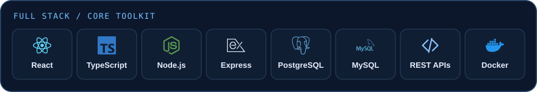

  <picture>
    <source media="(max-width: 600px)" srcset="./assets/v3/en/hero-mobile.svg">
    
  </picture>

  
  &nbsp;
  
  &nbsp;
  

  <a href="#projects">Projects</a> &nbsp;·&nbsp;
  <a href="#stack">Stack</a> &nbsp;·&nbsp;
  <a href="#activity">Activity</a> &nbsp;·&nbsp;
  <a href="#about">About</a> &nbsp;·&nbsp;
  <a href="#contact">Contact</a>

I am **Angel Ayuquina**, a Software Engineering student at Universidad Técnica de Ambato, based in **Ambato, Ecuador**. I build **full stack applications**, connecting React interfaces with Node.js APIs, SQL databases and deployment. I am looking for a **junior full stack role or internship** where I can contribute and keep learning with a team.

<h2>
  <picture>
  <source media="(max-width: 600px)" srcset="./assets/v3/en/h1-mobile.svg">
  
</picture>
</h2>

A selection of my **academic and personal projects**, with the problem each one addresses and my contributions to its implementation. Each card links to the code.

  
  

  
  

  

<h2>
  <picture>
  <source media="(max-width: 600px)" srcset="./assets/v3/en/h2-mobile.svg">
  
</picture>
</h2>

My main stack connects **React + TypeScript**, **Node.js + Express** and **PostgreSQL / MySQL**, with **REST APIs and Docker** across the workflow.

<picture>
  <source media="(max-width: 600px)" srcset="./assets/v3/en/stack-core-mobile.svg">
  
</picture>

**Deployment:** I prepare builds, configure environment variables and publish applications, with additional knowledge of **Azure, Render and Vercel**.

The complete toolbox below includes my other tools and areas of practice. **Primary use** and **knowledge** describe how I use them, rather than proficiency scores.

<picture>
  <source media="(max-width: 600px)" srcset="./assets/v3/en/stack-mobile.svg">
  
</picture>

<h2>
  <picture>
  <source media="(max-width: 600px)" srcset="./assets/v3/en/h3-mobile.svg">
  
</picture>
</h2>

  <a href="https://github.com/T1Angel4220">
    <picture>
      <source media="(prefers-color-scheme: dark)" srcset="https://raw.githubusercontent.com/T1Angel4220/T1Angel4220/output/github-snake-dark.svg">
      <source media="(prefers-color-scheme: light)" srcset="https://raw.githubusercontent.com/T1Angel4220/T1Angel4220/output/github-snake.svg">
      
    </picture>
  </a>

<h2>
  <picture>
  <source media="(max-width: 600px)" srcset="./assets/v3/en/h4-mobile.svg">
  
</picture>
</h2>

<picture>
  <source media="(max-width: 600px)" srcset="./assets/v3/en/about-mobile.svg">
  
</picture>

<h2>
  <picture>
  <source media="(max-width: 600px)" srcset="./assets/v3/en/h5-mobile.svg">
  
</picture>
</h2>

I am open to **junior full stack roles and internships**. For my background and training, view my **[résumé (PDF · Spanish)](./Angel_Ayuquina_CV.pdf)** or connect with me on **[LinkedIn](https://www.linkedin.com/in/angel-ayuquina4220/)**.

   
  <a href="mailto:ayuquinaangel4220@gmail.com">ayuquinaangel4220@gmail.com</a>

  
  &nbsp;
  

<picture>
  <source media="(max-width: 600px)" srcset="./assets/v3/en/footer-mobile.svg">
  
</picture>

  <a href="#top">↑ Back to top</a>

