

  🌐 <a href="./README.md" lang="es">Español</a> &nbsp;·&nbsp; <strong>English</strong>

  <picture>
    <source media="(prefers-reduced-motion: reduce)" srcset="./assets/profile-header.png">
    
  </picture>

<h1 align="center">👋 I'm Angel Ayuquina</h1>

  <strong>🎨 Frontend Developer</strong> &nbsp; / &nbsp; 🧩 Full Stack

  <strong>🟢 Open to junior Frontend / Full Stack roles</strong> 
  🎓 In the final stretch of Software Engineering · Universidad Técnica de Ambato · 🌎 Ecuador

  
  &nbsp;
  

  <a href="#value">✨ My approach</a> &nbsp;·&nbsp;
  <a href="#projects">🚀 Projects</a> &nbsp;·&nbsp;
  <a href="#stack">🛠️ Stack</a> &nbsp;·&nbsp;
  <a href="#activity">🐍 Activity</a> &nbsp;·&nbsp;
  <a href="#about">🐾 About me</a> &nbsp;·&nbsp;
  <a href="#contact">🤝 Contact</a>


## ✨ What I bring to a team

  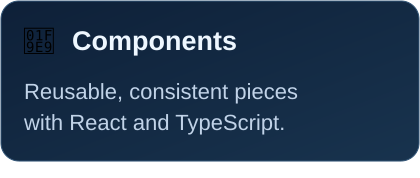
  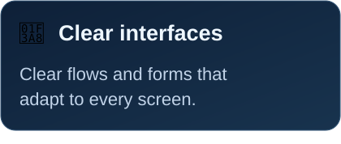
  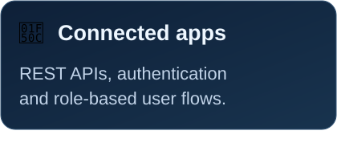

## 🚀 Projects, from code to screen

A selection of my **academic and personal projects**. The first two cards show actual application screens; explore the code or open the full-size captures below. 👇

  <a href="https://github.com/T1Angel4220/eventconnect"></a>
  <a href="https://github.com/T1Angel4220/AD-GestionHospitalaria"></a>

  📸 Full-size captures: <a href="./assets/screens/eventconnect.png">EventConnect</a> · <a href="./assets/screens/eventconnect-dark.png">EventConnect — dark</a> · <a href="./assets/screens/hospitalapp.png">HospitalApp</a>

  <a href="https://github.com/T1Angel4220/SistemaVentas"></a>
  <a href="https://github.com/T1Angel4220/Sistema_Mantenimiento">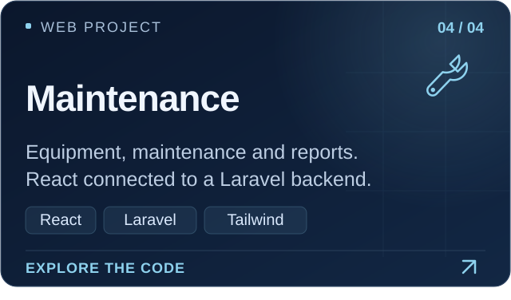</a>

  <a href="https://github.com/T1Angel4220?tab=repositories">🔎 Explore all my repositories ↗</a>

<a href="#top">↑ Back to top</a>

## 🛠️ What I build with

  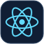
  
  
  
  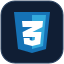
  
  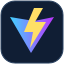

- **🎨 Interface:** React · TypeScript · JavaScript · HTML · CSS · Tailwind CSS · Vite.
- **🔄 State and routing:** React Router · Context API · Zustand.
- **🔌 Integration:** REST APIs, authentication and role-based user permissions.

<strong>🧩 Backend, mobile and other projects</strong>

- **⚙️ Backend:** Node.js · Express · PHP · Laravel.
- **🗄️ Data:** PostgreSQL · MySQL.
- **🔧 Tools:** Git · GitHub · Docker.

**📱 [EventConnect Mobile](https://github.com/T1Angel4220/eventconnect-movil)** — React Native, Expo and TypeScript for discovering events and managing registrations.

**🤖 [Agente Telegram](https://github.com/T1Angel4220/AgenteTelegram)** — NestJS and TypeScript connecting Telegram, GitHub and Trello.

**⛽ [Combustible SKT](https://github.com/T1Angel4220/Combustible-SKT)** — Microservices with Java, Spring Boot, gRPC and Docker.

<a href="#top">↑ Back to top</a>

## 🐍 My activity, one commit at a time

My public contributions, turned into an animation that updates daily. A little consistency, a little play. ✨

  <a href="https://github.com/T1Angel4220">
    <picture>
      <source media="(prefers-color-scheme: dark)" srcset="https://raw.githubusercontent.com/T1Angel4220/T1Angel4220/output/github-snake-dark.svg">
      <source media="(prefers-color-scheme: light)" srcset="https://raw.githubusercontent.com/T1Angel4220/T1Angel4220/output/github-snake.svg">
      
    </picture>
  </a>

<a href="#top">↑ Back to top</a>

## 🐾 Outside the editor

I enjoy learning by building, paying attention to interface details and understanding what happens after each click. **Frontend** is my focus, with the curiosity to connect the whole application.

  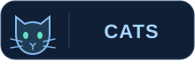
  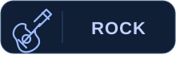
  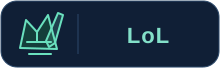

- 🐈 **My weakness:** cats.
- 🎸 **My music:** rock, of course.
- 🎮 **To unwind:** a few games of League of Legends.
- 💙 **My favorite color:** midnight blue. You might have noticed.

  

<a href="#top">↑ Back to top</a>

## 🤝 Shall we build something together?

I'm looking for a **junior frontend or full stack opportunity** where I can contribute to a product, learn from other developers and grow with a team. If my profile fits what you're building, let's talk. ✉️

  

  <a href="mailto:aayuquina4220@uta.edu.ec">aayuquina4220@uta.edu.ec</a> 
  <a href="./README.md" lang="es">Leer en español</a> &nbsp;·&nbsp; <strong>English</strong>

  💙 Thanks for stopping by. A little code, a little rock and a cat or two. 🐾 
  <a href="#top">↑ Back to top</a>

