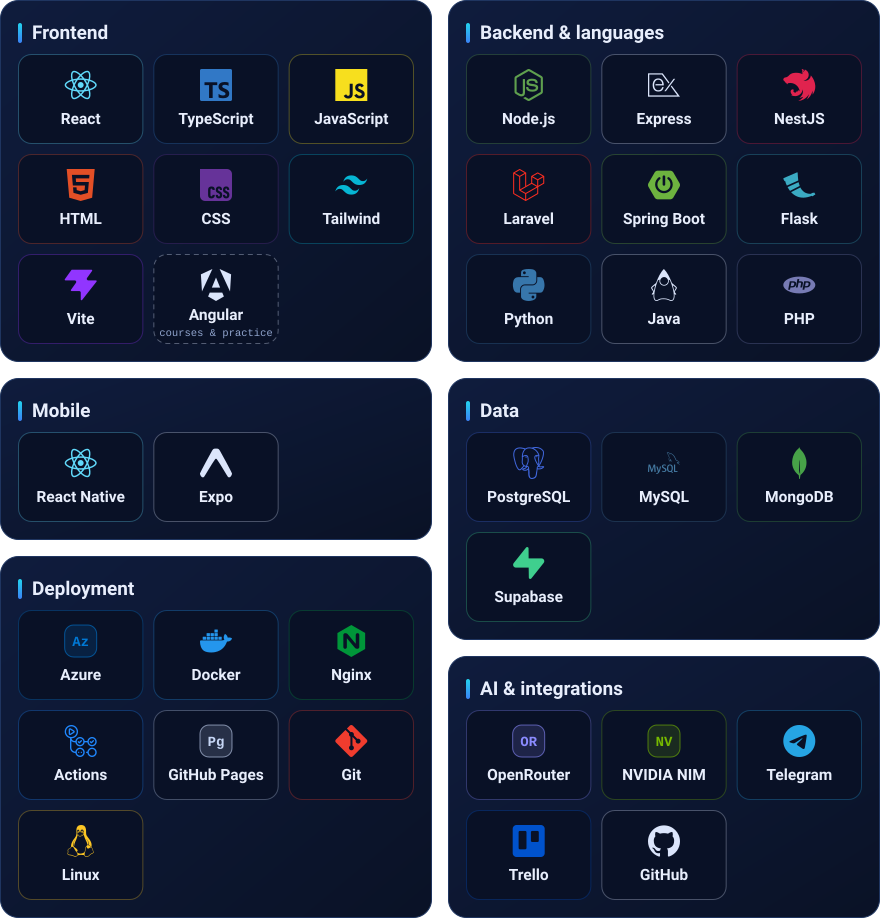

  🌐 <strong>Español</strong> &nbsp;·&nbsp; <a href="#user-content-english" lang="en">English</a>

  <picture>
    <source media="(max-width: 600px)" srcset="./assets/v3/es/hero-mobile.svg">
    
  </picture>

  
  &nbsp;
  

  <a href="#projects">Proyectos</a> &nbsp;·&nbsp;
  <a href="#stack">Stack</a> &nbsp;·&nbsp;
  <a href="#activity">Actividad</a> &nbsp;·&nbsp;
  <a href="#about">Sobre&nbsp;mí</a> &nbsp;·&nbsp;
  <a href="#contact">Contacto</a>

Desarrollo aplicaciones web de punta a punta con **React y TypeScript**: interfaz, API y base de datos. Estoy en la recta final de Ingeniería en Software en la Universidad Técnica de Ambato (Ecuador) y busco mi primer rol **junior en frontend o full stack**.

<h2>
  
</h2>

Una selección de mis **proyectos académicos y personales**. Cada tarjeta lleva al código.

  
  

  
  

  

<h2>
  
</h2>

Mi foco es **frontend**. Lo conecto con APIs, bases de datos y servicios en la nube, y también preparo builds, configuro variables de entorno y publico aplicaciones con **Azure, Docker, Nginx y GitHub Pages**.

<picture>
  <source media="(max-width: 600px)" srcset="./assets/v3/es/stack-mobile.svg">
  
</picture>

<h2>
  
</h2>

  <a href="https://github.com/T1Angel4220">
    <picture>
      <source media="(prefers-color-scheme: dark)" srcset="https://raw.githubusercontent.com/T1Angel4220/T1Angel4220/output/github-snake-dark.svg">
      <source media="(prefers-color-scheme: light)" srcset="https://raw.githubusercontent.com/T1Angel4220/T1Angel4220/output/github-snake.svg">
      
    </picture>
  </a>

<h2>
  
</h2>

<h2>
  
</h2>

Busco una oportunidad **junior en frontend o full stack** para aportar a un producto, aprender de otros desarrolladores y crecer en equipo. Si mi perfil encaja con lo que estás construyendo, conversemos.

   
  <a href="mailto:ayuquinaangel4220@gmail.com">ayuquinaangel4220@gmail.com</a>

  <a href="#user-content-english" lang="en">Read in English</a> &nbsp;·&nbsp; <a href="#top">↑ Volver arriba</a>

<strong>🌐 English — read this profile in English</strong>

  🌐 <a href="#user-content-es" lang="es">Español</a> &nbsp;·&nbsp; <strong>English</strong>

  <picture>
    <source media="(max-width: 600px)" srcset="./assets/v3/en/hero-mobile.svg">
    
  </picture>

  
  &nbsp;
  

  <a href="#user-content-projects-en">Projects</a> &nbsp;·&nbsp;
  <a href="#user-content-stack-en">Stack</a> &nbsp;·&nbsp;
  <a href="#user-content-activity-en">Activity</a> &nbsp;·&nbsp;
  <a href="#user-content-about-en">About</a> &nbsp;·&nbsp;
  <a href="#user-content-contact-en">Contact</a>

I build web applications end to end with **React and TypeScript**: interface, API and database. I am finishing my Software Engineering degree at Universidad Técnica de Ambato (Ecuador) and I am looking for my first **junior frontend or full stack role**.

<h2>
  
</h2>

A selection of my **academic and personal projects**. Each card links to the code.

  
  

  
  

  

<h2>
  
</h2>

My focus is **frontend**. I connect it to APIs, databases and cloud services, and I also prepare builds, configure environment variables and deploy applications with **Azure, Docker, Nginx and GitHub Pages**.

<picture>
  <source media="(max-width: 600px)" srcset="./assets/v3/en/stack-mobile.svg">
  
</picture>

<h2>
  
</h2>

  <a href="https://github.com/T1Angel4220">
    <picture>
      <source media="(prefers-color-scheme: dark)" srcset="https://raw.githubusercontent.com/T1Angel4220/T1Angel4220/output/github-snake-dark.svg">
      <source media="(prefers-color-scheme: light)" srcset="https://raw.githubusercontent.com/T1Angel4220/T1Angel4220/output/github-snake.svg">
      
    </picture>
  </a>

<h2>
  
</h2>

<h2>
  
</h2>

I am looking for a **junior frontend or full stack** opportunity where I can contribute to a product, learn from other developers and grow with a team. If my profile fits what you are building, let us talk.

   
  <a href="mailto:ayuquinaangel4220@gmail.com">ayuquinaangel4220@gmail.com</a>

  <a href="#user-content-es" lang="es">Leer en español</a> &nbsp;·&nbsp; <a href="#user-content-top-en">↑ Back to top</a>

