

  🌐 <strong>Español</strong> &nbsp;·&nbsp; <a href="./README.en.md" lang="en">English</a>

  <picture>
    <source media="(max-width: 600px)" srcset="./assets/v3/es/hero-mobile.svg">
    
  </picture>

  
  &nbsp;
  

  <a href="#projects">Proyectos</a> &nbsp;·&nbsp;
  <a href="#stack">Stack</a> &nbsp;·&nbsp;
  <a href="#activity">Actividad</a> &nbsp;·&nbsp;
  <a href="#about">Sobre&nbsp;mí</a> &nbsp;·&nbsp;
  <a href="#contact">Contacto</a>

Desarrollo aplicaciones web de punta a punta con **React y TypeScript**: interfaz, API y base de datos. Estoy en la recta final de Ingeniería en Software en la Universidad Técnica de Ambato (Ecuador) y busco mi primer rol **junior en frontend o full stack**.

<h2>
  
</h2>

Una selección de mis **proyectos académicos y personales**. Cada tarjeta lleva al código.

  <a href="https://github.com/T1Angel4220/eventconnect"></a>
  <a href="https://github.com/T1Angel4220/AD-GestionHospitalaria">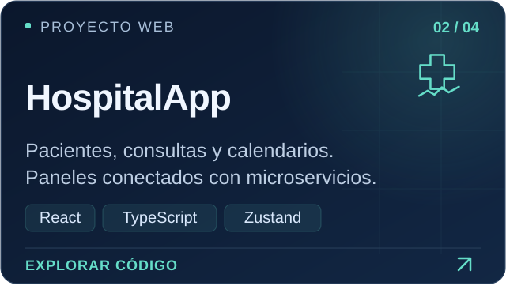</a>

  <a href="https://github.com/T1Angel4220/SistemaVentas"></a>
  <a href="https://github.com/T1Angel4220/AgenteTelegram"></a>

  

<h2>
  
</h2>

Mi foco es **frontend**. Lo conecto con APIs, bases de datos y servicios en la nube, y también preparo builds, configuro variables de entorno y publico aplicaciones con **Azure, Docker, Nginx y GitHub Pages**.

<picture>
  <source media="(max-width: 600px)" srcset="./assets/v3/es/stack-mobile.svg">
  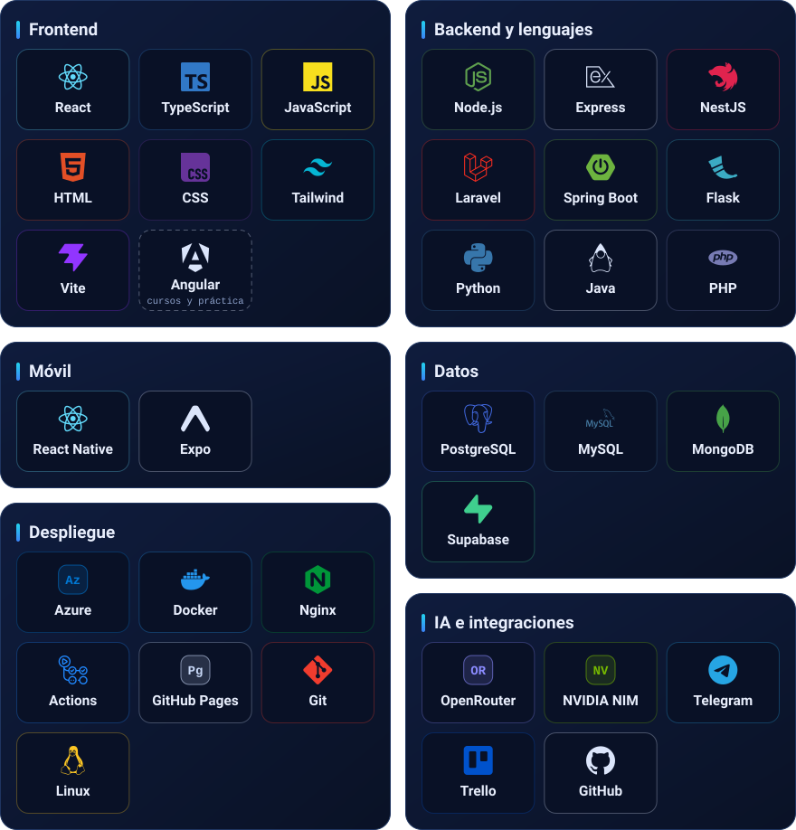
</picture>

<h2>
  
</h2>

  <a href="https://github.com/T1Angel4220">
    <picture>
      <source media="(prefers-color-scheme: dark)" srcset="https://raw.githubusercontent.com/T1Angel4220/T1Angel4220/output/github-snake-dark.svg">
      <source media="(prefers-color-scheme: light)" srcset="https://raw.githubusercontent.com/T1Angel4220/T1Angel4220/output/github-snake.svg">
      
    </picture>
  </a>

<h2>
  
</h2>


<h2>
  
</h2>

Busco una oportunidad **junior en frontend o full stack** para aportar a un producto, aprender de otros desarrolladores y crecer en equipo. Si mi perfil encaja con lo que estás construyendo, conversemos.

   
  <a href="mailto:ayuquinaangel4220@gmail.com">ayuquinaangel4220@gmail.com</a>

  <a href="./README.en.md" lang="en">Read in English</a> &nbsp;·&nbsp; <a href="#top">↑ Volver arriba</a>

