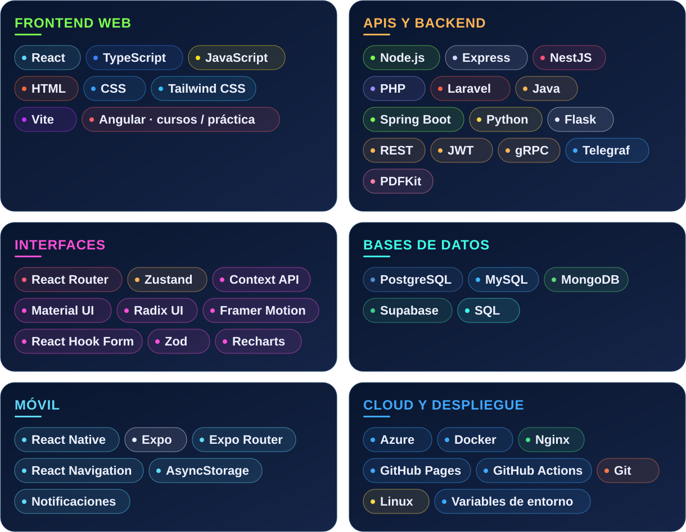
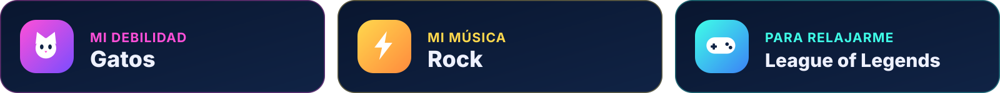

  🌐 <strong>Español</strong> &nbsp;·&nbsp; <a href="./README.en.md" lang="en">English</a>

  <picture>
    <source media="(prefers-reduced-motion: reduce)" srcset="./assets/profile-header.png">
    
  </picture>

<h1 align="center">
<picture>
  <source media="(max-width: 600px) and (prefers-reduced-motion: reduce)" srcset="./assets/v2/es/intro-mobile-still.svg">
  <source media="(max-width: 600px)" srcset="./assets/v2/es/intro-mobile.svg">
  <source media="(prefers-reduced-motion: reduce)" srcset="./assets/v2/es/intro-still.svg">
  
</picture>
</h1>

  🎓 En la recta final de Ingeniería en Software · Universidad Técnica de Ambato · 🌎 Ecuador

  
  &nbsp;
  

  <a href="#projects">🚀 Proyectos</a> &nbsp;·&nbsp;
  <a href="#stack">🛠️ Stack</a> &nbsp;·&nbsp;
  <a href="#activity">🐍 Actividad</a> &nbsp;·&nbsp;
  <a href="#about">🐾 Sobre&nbsp;mí</a> &nbsp;·&nbsp;
  <a href="#contact">🤝 Contacto</a>

<h2>
<picture>
  <source media="(max-width: 600px)" srcset="./assets/v2/es/h-projects-mobile.svg">
  
</picture>
</h2>

Interfaces web, gestión de eventos y automatización con IA: una selección de mis **proyectos académicos y personales**. 👇

  
  

  
  

**🤖 LUPSI ChatOps** conecta Telegram con Trello y GitHub para consultar avances, recuperar contexto de documentos y generar reportes PDF. Incluye flujos de aprobación humana para ciertas acciones.

  📸 Vistas completas: <a href="./assets/screens/eventconnect.png">EventConnect</a> · <a href="./assets/screens/hospitalapp.png">HospitalApp</a> · <a href="./assets/screens/sales.png">Ventas</a> · <a href="./assets/screens/telegram-hitl.png">LUPSI (vista del repositorio)</a>

<strong>🧩 Más proyectos donde aplico este stack</strong>

**📱 [EventConnect Mobile](https://github.com/T1Angel4220/eventconnect-movil)** — React Native, Expo y TypeScript para descubrir eventos, gestionar inscripciones y recibir notificaciones.

**⛽ [Combustible SKT](https://github.com/T1Angel4220/Combustible-SKT)** — Microservicios con Java, Spring Boot, gRPC, MongoDB, PostgreSQL y Docker.

**🐍 [Mensajes y videollamadas](https://github.com/T1Angel4220/Mensajes_VideoLlamada)** — Python, Flask, JavaScript y WebRTC.

**🖥️ [Calculadora de aproximación](https://github.com/T1Angel4220/CalculadoraAproximacion)** — Python, PySide6, NumPy y Matplotlib.

  <a href="https://github.com/T1Angel4220?tab=repositories">🔎 Explorar todos mis repositorios ↗</a>

<h2>
<picture>
  <source media="(max-width: 600px)" srcset="./assets/v2/es/h-stack-mobile.svg">
  
</picture>
</h2>

Mi foco es **frontend**. Lo conecto con APIs, bases de datos y servicios en la nube. También preparo builds, configuro variables de entorno y publico aplicaciones con **Azure, Docker, Nginx y GitHub Pages**.

<picture>
  <source media="(max-width: 600px)" srcset="./assets/v2/es/stack-mobile.svg">
  
</picture>

🧠 **IA e integraciones:** OpenRouter · NVIDIA NIM · Telegraf · APIs de Trello y GitHub · PDFKit · recuperación de contexto documental.

<h2>
<picture>
  <source media="(max-width: 600px)" srcset="./assets/v2/es/h-activity-mobile.svg">
  
</picture>
</h2>

  <a href="https://github.com/T1Angel4220">
    <picture>
      <source media="(prefers-color-scheme: dark)" srcset="https://raw.githubusercontent.com/T1Angel4220/T1Angel4220/output/github-snake-dark.svg">
      <source media="(prefers-color-scheme: light)" srcset="https://raw.githubusercontent.com/T1Angel4220/T1Angel4220/output/github-snake.svg">
      
    </picture>
  </a>

<h2>
<picture>
  <source media="(max-width: 600px)" srcset="./assets/v2/es/h-about-mobile.svg">
  
</picture>
</h2>

Me gusta aprender construyendo, cuidar los detalles de una interfaz y entender qué ocurre después de cada clic.

<picture>
  <source media="(max-width: 600px)" srcset="./assets/v2/es/interests-mobile.svg">
  
</picture>

💙 Mi color: azul oscuro. Se nota un poquito, ¿no?

<h2>
<picture>
  <source media="(max-width: 600px)" srcset="./assets/v2/es/h-contact-mobile.svg">
  
</picture>
</h2>

Busco una oportunidad **junior en frontend o full stack** para aportar a un producto, aprender de otros desarrolladores y crecer en equipo. Si mi perfil encaja con lo que estás construyendo, conversemos. ✉️

   
  <a href="mailto:aayuquina4220@uta.edu.ec">aayuquina4220@uta.edu.ec</a>

<picture>
  <source media="(max-width: 600px)" srcset="./assets/v2/es/footer-mobile.svg">
  
</picture>

  <a href="./README.en.md" lang="en">Read in English</a> &nbsp;·&nbsp; <a href="#top">↑ Volver arriba</a>

