

  🌐 <strong>Español</strong> &nbsp;·&nbsp; <a href="./README.en.md" lang="en">English</a>

  <picture>
    <source media="(prefers-reduced-motion: reduce)" srcset="./assets/profile-header.png">
    
  </picture>

<h1 align="center">👋 Soy Angel Ayuquina</h1>

  <strong>🎨 Desarrollador Frontend</strong> &nbsp; / &nbsp; 🧩 Full Stack

  <strong>🟢 Buscando mi próximo equipo junior de Frontend / Full Stack</strong> 
  🎓 En la recta final de Ingeniería en Software · Universidad Técnica de Ambato · 🌎 Ecuador

  
  &nbsp;
  

  <a href="#value">✨ Aporto</a> &nbsp;·&nbsp;
  <a href="#projects">🚀 Proyectos</a> &nbsp;·&nbsp;
  <a href="#stack">🛠️ Stack</a> &nbsp;·&nbsp;
  <a href="#activity">🐍 Actividad</a> &nbsp;·&nbsp;
  <a href="#about">🐾 Sobre mí</a> &nbsp;·&nbsp;
  <a href="#contact">🤝 Contacto</a>

## ✨ Lo que aporto a un equipo

Construyo interfaces, conecto servicios y llevo las aplicaciones hasta su publicación en la web. ☁️

  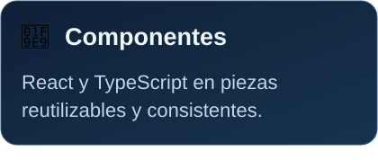
  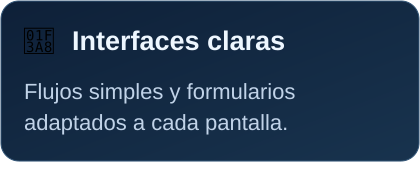
  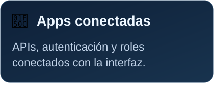

## 🚀 Proyectos, del código a la pantalla

Una selección de mis **proyectos académicos y personales**. Las cuatro tarjetas muestran pantallas reales de sus aplicaciones; puedes explorar el código o abrir las capturas completas. 👇

  
  

  📸 Capturas completas: <a href="./assets/screens/eventconnect.png">EventConnect</a> · <a href="./assets/screens/eventconnect-dark.png">EventConnect — oscuro</a> · <a href="./assets/screens/hospitalapp.png">HospitalApp</a>

  
  <a href="https://github.com/T1Angel4220/Sistema_Mantenimiento">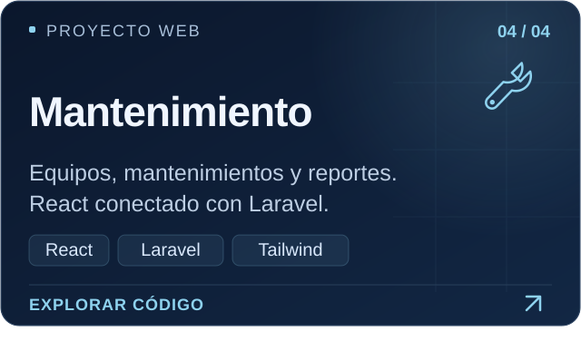</a>

  📸 Capturas completas: <a href="./assets/screens/sales.png">Sistema de Ventas</a> · <a href="./assets/screens/sales-home.png">Ventas — inicio</a> · <a href="./assets/screens/maintenance.png">Mantenimiento</a>

  <a href="https://github.com/T1Angel4220?tab=repositories">🔎 Explorar todos mis repositorios ↗</a>

<a href="#top">↑ Volver arriba</a>

## 🛠️ Mi stack, de la interfaz al despliegue

Mi foco es **frontend**, con experiencia práctica conectando aplicaciones web y móviles con APIs, bases de datos y servicios en la nube.

  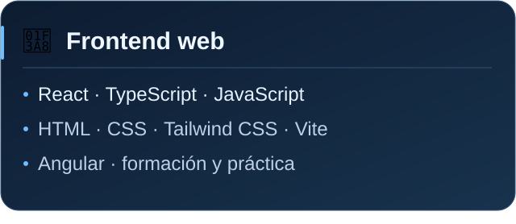
  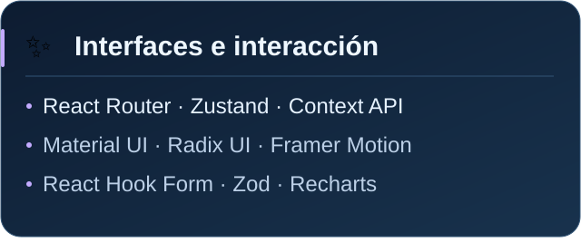

  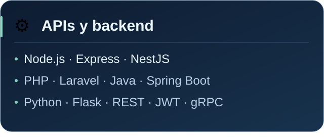
  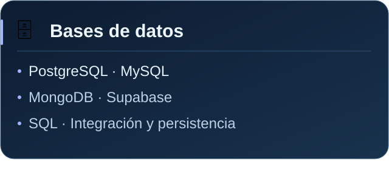

  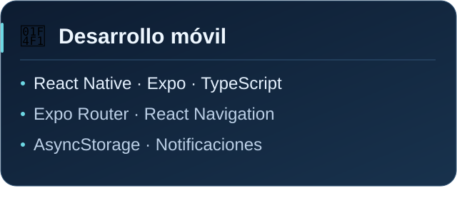
  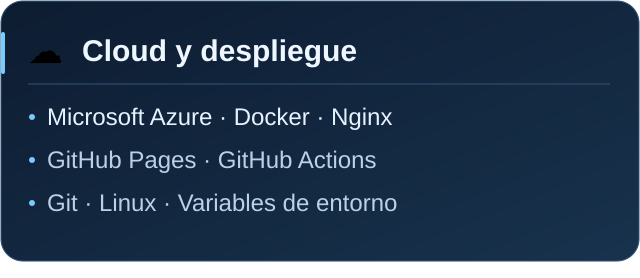

> ☁️ **También llevo proyectos a la web:** preparo builds, configuro variables de entorno y conecto frontend, APIs y bases de datos para publicar aplicaciones. Trabajo con **Azure, Docker y Nginx**, y con **GitHub Pages** para sitios estáticos.

<strong>🧩 Más proyectos donde aplico este stack</strong>

**📱 [EventConnect Mobile](https://github.com/T1Angel4220/eventconnect-movil)** — React Native, Expo y TypeScript para descubrir eventos, gestionar inscripciones y recibir notificaciones.

**🤖 [Agente Telegram](https://github.com/T1Angel4220/AgenteTelegram)** — NestJS, TypeScript y Supabase para integrar Telegram, GitHub y Trello.

**⛽ [Combustible SKT](https://github.com/T1Angel4220/Combustible-SKT)** — Microservicios con Java, Spring Boot, gRPC, MongoDB, PostgreSQL y Docker.

**🐍 [Mensajes y videollamadas](https://github.com/T1Angel4220/Mensajes_VideoLlamada)** — Python, Flask, JavaScript y WebRTC.

**🖥️ [Calculadora de aproximación](https://github.com/T1Angel4220/CalculadoraAproximacion)** — Python, PySide6, NumPy y Matplotlib.

<a href="#top">↑ Volver arriba</a>

## 🐍 Mi actividad, un commit a la vez

Mis contribuciones públicas, convertidas en una animación que se actualiza cada día. Un poco de constancia, un poco de juego. ✨

  <a href="https://github.com/T1Angel4220">
    <picture>
      <source media="(prefers-color-scheme: dark)" srcset="https://raw.githubusercontent.com/T1Angel4220/T1Angel4220/output/github-snake-dark.svg">
      <source media="(prefers-color-scheme: light)" srcset="https://raw.githubusercontent.com/T1Angel4220/T1Angel4220/output/github-snake.svg">
      
    </picture>
  </a>

<a href="#top">↑ Volver arriba</a>

## 🐾 Fuera del editor

Me gusta aprender construyendo, cuidar los detalles de una interfaz y entender qué ocurre después de cada clic. Mi foco está en **frontend**, con la curiosidad para conectar la aplicación completa.

  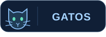
  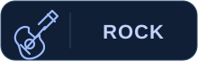
  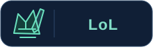

- 🐈 **Mi debilidad:** los gatos.
- 🎸 **Mi música:** rock, por supuesto.
- 🎮 **Para desconectar:** unas partidas de League of Legends.
- 💙 **Mi color:** azul oscuro. Se nota un poquito, ¿no?

  

<a href="#top">↑ Volver arriba</a>

## 🤝 ¿Construimos algo juntos?

Busco una oportunidad **junior en frontend o full stack** para aportar a un producto, aprender de otros desarrolladores y crecer en equipo. Si mi perfil encaja con lo que estás construyendo, conversemos. ✉️

  

  <a href="mailto:aayuquina4220@uta.edu.ec">aayuquina4220@uta.edu.ec</a> 
  <strong>Español</strong> &nbsp;·&nbsp; <a href="./README.en.md" lang="en">Read in English</a>

  💙 Gracias por pasarte. Entre código, rock y uno que otro gato. 🐾 
  <a href="#top">↑ Volver arriba</a>

